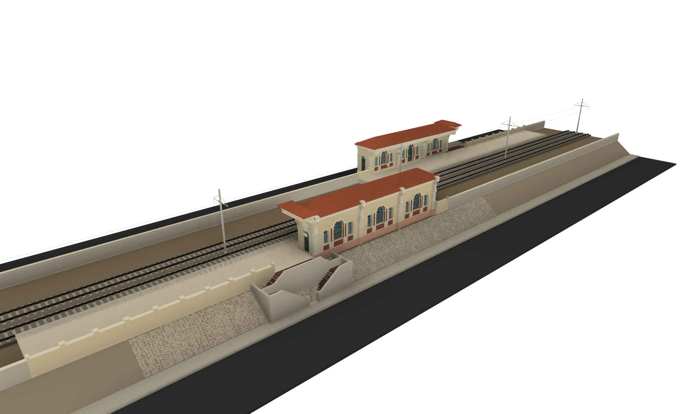
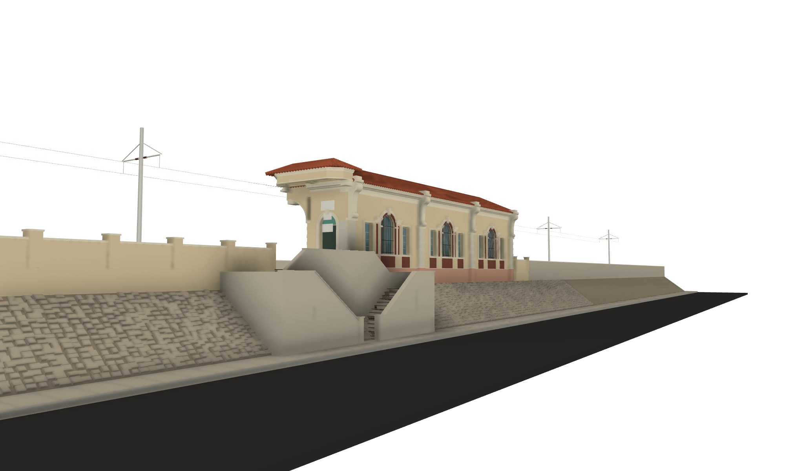
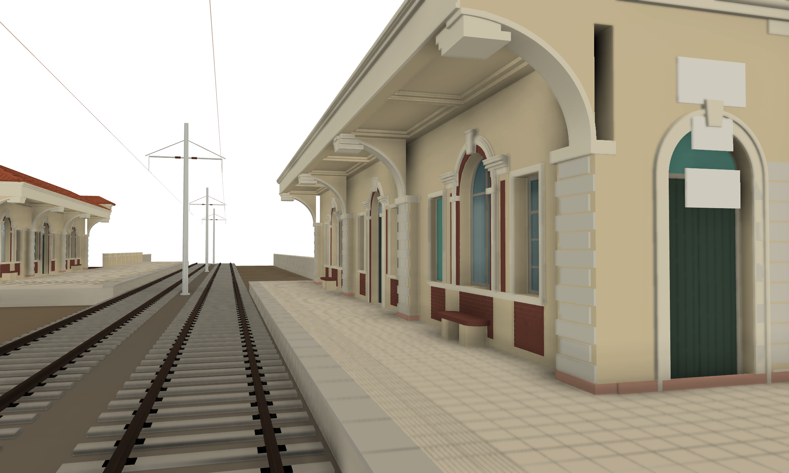
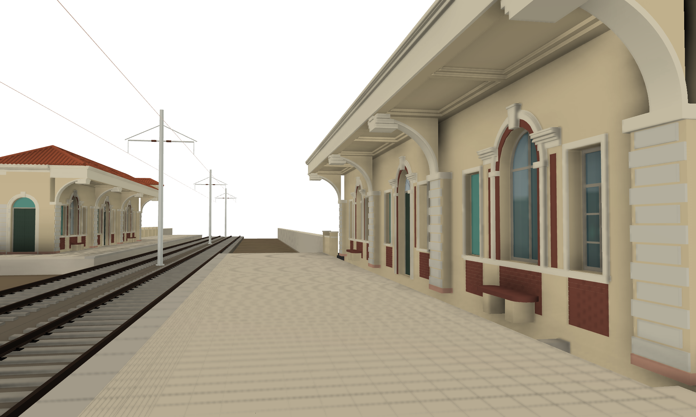

# Alexandria tram station — Sporting El Soghra

A detailed, parametric 1:1 CAD model of **Sporting El Soghra** (محطة الرياضة الصغرى, "Minor Sporting"), a stop
of the Alexandria **Raml tram** on the embankment in the median of Omar Lotfi Street, opposite the Alexandria
Sporting Club: two Italianate tile-roofed station pavilions on staggered side platforms, the double track, the
stone-pitched embankment and the concrete stairs down to the street. Modelled as it stood in 2024–26, slightly
weathered.

## Where and what
- **Location:** Alexandria, Egypt, ≈ 31.21665 N, 29.93013 E (Bab Sharq / El Ibrahimiya Bahary), between Ibrahimiya
  and Sporting El Kobra on the trunk shared by both Raml routes. Track bearing ≈ 55°.
- **Layout:** the tram runs on an embankment ≈ 3.4 m above the street. Each side platform carries a pavilion at
  its street edge; the two are **point-symmetric twins**, staggered by about one pavilion length, each with a
  tile-roofed canopy and a stair to its carriageway at its outer end (south pavilion: canopy and stair at the west
  end; north pavilion: at the east end).
- **Architecture:** single tall storey, three bays per side. Street side: rusticated pilasters with large scroll
  consoles rising above the eaves, tripartite windows (round-arched central light with brick archivolt and
  keystone, narrow side lights under hood cornices), exposed-brick dado panels, pink plinth, moulded cornice,
  hipped Roman/Marseille tile roof. Platform side: rusticated piers carrying transverse arch ribs and a deep
  eave with a coffered soffit, benches, doors. Architect and date unknown; the style suggests the 1920s–30s
  Alexandria & Ramleh Railway era (estimate).
- **Status:** the Raml line closed in stages in 2026 (this section from 4 April 2026) for the rebuild by the
  National Authority for Tunnels, in which Sporting El Soghra is not a station. Both pavilions were **standing on
  22 June 2026** (video below) but are not on the published heritage list and fall within the demolition tender
  for the line's platforms and stations. Threatened.

## What's modelled
| Area | Content |
|---|---|
| Pavilion walls | 0.45 m rendered walls on a 0.9 m street-side plinth, open waiting hall with ceiling, floor |
| Street facade | 4 block-rusticated pilasters (corner quoins wrap the ends) with scroll consoles (lower and upper volutes, cavetto body, sunk cheek panels, cap above the eaves); frieze and mitred moulded cornice |
| Windows (both sides) | Tripartite: arched light with brick band, moulded archivolt, imposts and keystone; side lights with architraves and hood cornices; sill band; brick strips in the piers; brick dado panels in stretcher bond with sunk joints; timber frames, transoms and glazing bars; glass; wrought-iron grilles with scrolls in the street-side arched lights; teal boarding |
| Platform side | Rusticated piers with imposts, transverse arch ribs with edge bands, eave slab with two-step coffers, stepped corbels, moulded fascia; terrazzo benches with rounded ends; double door with fanlight in the middle bay |
| Ends and canopy | Arched doorways with archivolts, boarded double doors and fanlights; signboards; west canopy with chamfered corners, coffered soffit, layered fascia mouldings and its own hipped tile roof |
| Roofs | Hipped, 27°, Roman-tile rolls at 0.21 m with round ends at the eaves, hip and ridge cappings |
| Platforms | Deck, 300 mm grooved cement paving, ribbed strip, coping stones with nosing and joints, street-side parapets with piers and copings, boundary walls where there is no platform |
| Track | Double track, 1435 mm: flat-bottom rails, base plates and clips, concrete sleepers at 0.65 m, ballast |
| Embankment and street | Fill, 38° stone-pitched slopes with rubble stones, pavements with joints, kerbs, carriageway strips |
| Stairs | Double-return concrete stair: common foot, two 14-riser lower flights, half landings, two 6-riser return flights, head landing; tiled treads and risers with nosings; sloping parapets with copings and newels |
| Overhead line | Centre poles, twin cantilevers, insulators, contact wires (context) |
| Finish | Weathered colours: cream/ochre render, grey-white rustication and trim, red brick, pink plinth, terracotta tiles, faded joinery, green doors, teal boards, stained concrete, rusty rails |

## Key dimensions
No drawings were found. Values come from the owner's photos (brick-course scale, semicircular-arch aspect, a
camera-matched overlay of IMG_3282 on the model), the 2024/2026 video frames, the 1435 mm gauge, Raml cars for
scale and a satellite crop. Full sheet with methods: [`references/notes/dimensions.md`](references/notes/dimensions.md).

| Dimension | Model | Confidence |
|---|---|---|
| Bays per long side | 3 | HIGH |
| Bay pitch (pilaster centres) | 7.40 m | MED-LOW (photo overlay confirms) |
| Pavilion length / depth | 22.96 m (+ 1.50 m canopy) / 2.70 m | MED-LOW / LOW-MED |
| Platform eave projection | 1.90 m | LOW |
| Brick dado | 12 courses × 70 mm = 0.84 m | MED |
| Arched central light | 1.44 × 2.44 m, crown 3.40 m above the platform | LOW-MED |
| Side lights | 0.82 × 1.81 m | LOW-MED |
| Eaves / console top / ridge above the platform | 4.95 / 5.25 / ≈ 6.2 m | LOW-MED / LOW / LOW |
| Roof pitch | 27° | LOW |
| Platform above top of rail / above the street | 0.35 m / 3.40 m | LOW-MED |
| Stairs | 14 + 6 risers of 170 mm, treads 230 mm, flights 1.50 m | LOW |
| Track gauge / track centres | 1435 mm / 3.40 m | HIGH / LOW |
| Stagger of the twins | symmetry axis 25.1 m east of the south pavilion's west wall | LOW |

Every dimension is a Fusion user parameter whose comment records its source and confidence.

## Files
| Fusion design (project *Eshera-Personal*, folder *Alexandria Tram Station - Sporting El Soghra*) | Export |
|---|---|
| **Sporting El Soghra Station** — both halves, track, overhead line | `models/` (see below) |

## Rebuilding from the scripts
The whole design is generated by the Fusion API scripts in [`fusion/scripts/`](fusion/scripts/) from the user
parameters: start from an empty hybrid design named *Sporting El Soghra Station* (or open the `.f3d`), run
`build_all.py` through the exec loader, change parameters, re-run. Loader, structure and build order:
[`fusion/README.md`](fusion/README.md).

## 3D printing
- 1:1 master. Scale on export: at 1:87 (H0) the pavilion is 264 mm long, at 1:160 (N) 144 mm.
- Thin parts (iron grille bars 18 mm, glazing bars, contact wire, rail clips, tile rolls) are below printable size
  at small scales; hide the `Overhead Line` component and thicken or drop the grilles in a print variant.
- Bodies are split by material (render, trim, rustication, brick, plinth, tiles, joinery, glass...), which helps
  multi-colour printing or painting.

## Known gaps
- Steps, roof and the south pavilion's platform side are not seen directly: stairs are interpreted from night
  photos (riser count ±2), the roof pitch is an estimate, and the platform side is taken from the north twin.
- Interior not seen (open hall assumed). No graffiti, litter, vegetation or the palm on the slope.
- Building depth, canopy and stagger rest on one photo overlay, the satellite block and one video bearing.
- Weathering is colour only.

## Sources and credits
Owner's photos (not published). Video references, used for measurement only and not reproduced:
Yasser Hayrouh Fein (ياسر هيروح فين), https://www.youtube.com/watch?v=O8mL_pUMLRQ (22 June 2026); ahmed salah
(@ahmedsalah1145), https://www.youtube.com/watch?v=RoMvXY75jS8 (2024). Esri World Imagery for the plan. Full list in
[`references/SOURCES.md`](references/SOURCES.md).

## Related repositories
- Raml tram set 221-223: https://github.com/imeshera/alexandria-tram-raml-221-223
- Raml double-deck car 224: https://github.com/imeshera/alexandria-tram-raml-dd-224
- City tram 1211-1212: https://github.com/imeshera/alexandria-tram-city-1211-1212
- GT6 tram 894: https://github.com/imeshera/alexandria-tram-gt6-894
- Heritage tram 601: https://github.com/imeshera/alexandria-tram-heritage-601
- Lada taxi: https://github.com/imeshera/alexandria-lada-taxi

## Licence
Code (`fusion/`): MIT, see [`LICENSE`](LICENSE). Models, documentation and renders: CC BY 4.0, see
[`LICENSE-models.md`](LICENSE-models.md). © 2026 Ibrahim Eshera.
